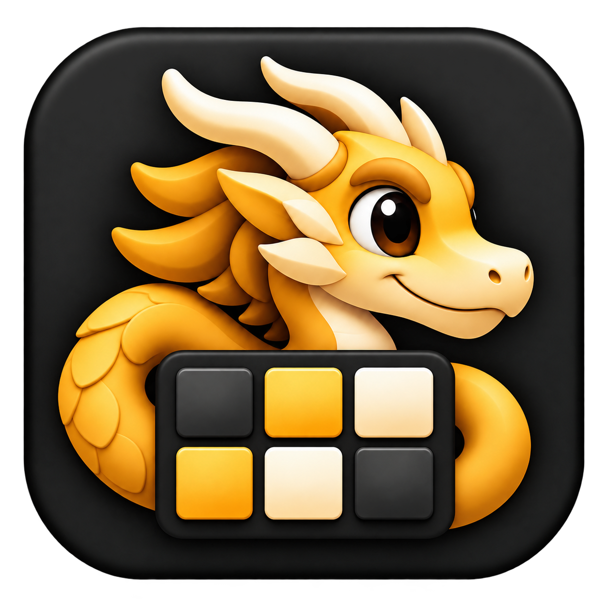

<p align="center">
  
</p>

# HIDHogg

A native Swift macOS app for configuring **Logitech MX Master 3S over a Bolt receiver** and **Ulanzi D200X** from one workspace. The mainline branch is `master`; acceptance is recorded per feature rather than claiming complete hardware compatibility.

## Current capabilities

- Back and Forward shortcut bindings, with defaults for all apps and per-app overrides.
- Vertical and thumb-wheel direction and custom scroll amount controls.
- Battery status, firmware information and optional low-battery notifications.
- A native device editor, menu-bar connection status, launch-at-login support and background operation.
- TOML configuration under `$XDG_CONFIG_HOME/hidhogg/` or `~/.config/hidhogg/`, automatic saving and manual reload.
- Bounded diagnostic activity with event IDs and source references.

Devices now have stable HidHogg registration UUIDs, with Add, Enable/Disable and Remove controls in the workspace. Sidebar and menu-bar entries follow the registry. Configuration uses a root registry plus versioned per-device TOML files; valid legacy configuration is migrated with an exact backup. Existing device settings, D200X actions/presets and image locations are preserved. This initial registry supports one registration per currently supported model; generic Bluetooth discovery/battery monitoring is the next slice. Device filenames use the model family, stable registration UUID and a 12-character SHA-256 revision. Obsolete recognizable payloads are cleaned after successful publication; the original migration backup is retained. See the [registry plan and migration checks](docs/device-registry-plan.md).

The D200X implementation includes one editable page, key/front-button/dial bindings, brightness 1–100, imported key images and title styling, automatic app profiles and independently editable tile presets. Named actions include media, volume, bell/sound, app/file/URL opening, deck notifications, shortcuts and custom executables. Actions, Tile presets and compact notification history have dedicated workspace pages. Topic filters support a simple `*` wildcard. It retains incremental updates and independent session maintenance. See the [workspace decisions and validation checklist](docs/d200x-workspace-evolution-plan.md) for current verification status.

Device-wide controls now include seven built-in wide-display modes, 12/24-hour time and an explicitly applied custom screensaver image. Notifications can display an installed application's icon using optional `app_id` / CLI `--app-id`, with text fallback; static notification actions and presets retain it. The earlier [display/icon baseline](docs/d200x-display-controls-plan.md) passed206 independent offline checks; the current mode/retained-preview follow-up passed38 focused checks. Other physical appearance, metrics availability and screensaver persistence remain [owner checks](docs/d200x-parity-owner-checks.md). The [Now Playing spike](docs/d200x-now-playing-spike.md) is a synthetic prototype and provider investigation, not a live player integration.

The signed `dist/hidhoggctl` supports notification emission/clearing/history and named action invocation. See the [D200X owner checks](docs/d200x-parity-owner-checks.md) for commands, execution limits and verification.

Wide-tile device images render at 458×196; the owner has confirmed improved physical text rendering. The current sleep trial retains the D200X connection, pauses maintenance and sets transient brightness to zero, then restores brightness on wake. Its physical sleep behaviour remains an owner check.

Multiple physical pages, notification-payload passing into actions, multi-actions, remaining telemetry/screensaver controls, Bluetooth transport and MCP remain deferred or proposed. See the [roadmap](docs/roadmap.md) and [check-in preparation](docs/checkin-preparation.md).

The original [Lofree Flow Lite84](docs/lofree-flow-lite-feasibility.md) now has signed receiver-based read-only status: battery/charging/voltage, keyboard firmware and lighting/OS snapshots. Routine refresh omits the unreliable receiver-firmware query. Offline/background checks pass; a full initial receiver read and later two receiver-status reads succeeded. Physical/app acceptance, battery accuracy, receiver firmware and the current keyboard-online flag discrepancy remain open. See the [evidence and owner checklist](docs/flow-lite84-implementation.md). Lighting now uses icon-labelled effect choices and five-stop sliders, with 200 ms debounced application/readback and separate connection-local Undo controls. Mac/Windows mode also applies automatically after 200 ms. The lighting choices form a four-by-two grid including Off. See the [controls plan](docs/flow-lite84-system-mode-plan.md) for scope and first physical-write checks.

The keyboard follows Connect on launch and supports keyboard-activity-triggered battery refresh at most hourly, with no polling timer. Activity from any keyboard qualifies; key contents are not accessed. Manual Refresh still reads the full status. The activity feature passes offline checks; live monitoring and battery impact remain owner checks.

## Build and run

Requires **Apple Silicon, macOS 26+**, an Xcode toolchain supporting Swift 6.2 or later, and a development-signing identity. Xcode does not need to be open.

```sh
bash scripts/build-app.sh --signing-identity YOUR_SIGNING_IDENTITY
open dist/Hidhogg.app
```

The signed app is built at the fixed path `dist/Hidhogg.app`. Grant the input permissions shown in Settings before using shortcut delivery or custom scroll amounts. Notification permission is separate and requested when enabling battery alerts.

See [build and signing instructions](docs/build.md) for cache paths, packaging and permission details. Build output is ignored by Git; builds do not launch the app or access devices.

## Project documentation

| Topic | Reference |
|---|---|
| Architecture and scope | [Overview](docs/overview.md) |
| Milestones and follow-ups | [Roadmap](docs/roadmap.md) |
| Modules and source layout | [Structure](docs/structure.md) |
| Diagnostic events | [Diagnostics](docs/diagnostics.md) |
| Design and mock-ups | [Design brief](docs/product-redesign/brief.md) |
| Device information and battery alerts | [Implementation plan and verification](docs/device-information-plan.md) |
| Historical implementation | [D200X/v2 archive](docs/archive/v2/README.md) |

The native Logitech and D200X implementation is maintained on `master`. The previous implementation is preserved at checkpoint `4b3248d` on `v2`.


The latest screensaver controls include a temporary five-second deck preview and a retained, collapsible last-sent image. Wide-mode switching and retained preview have owner confirmation. Additive icon-and-text notifications, badge counts and MCP configuration/device-state tools are requested next work, not current capabilities.
